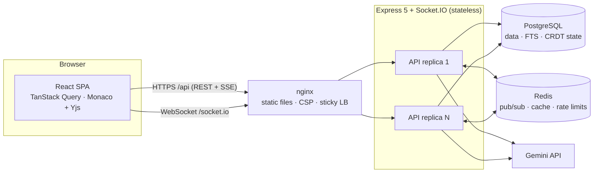
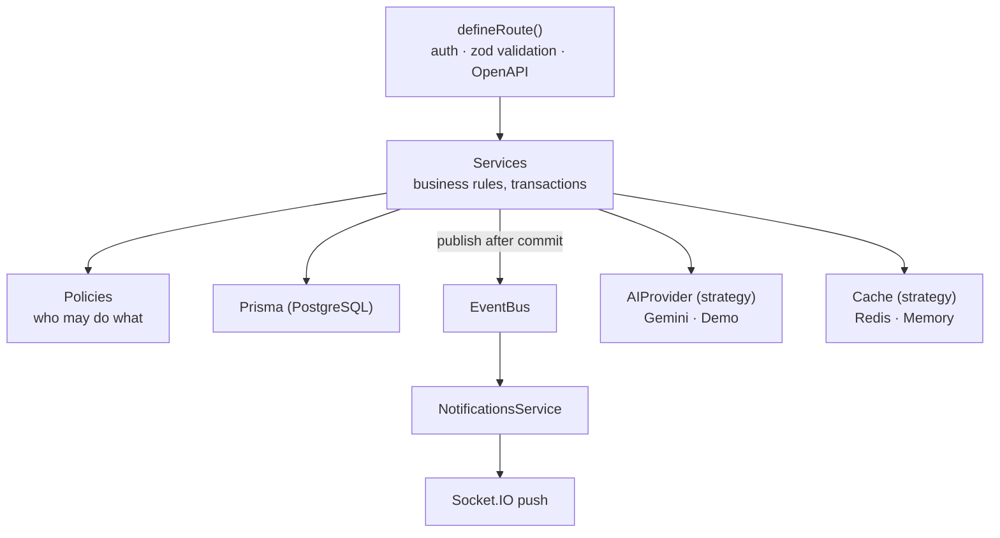
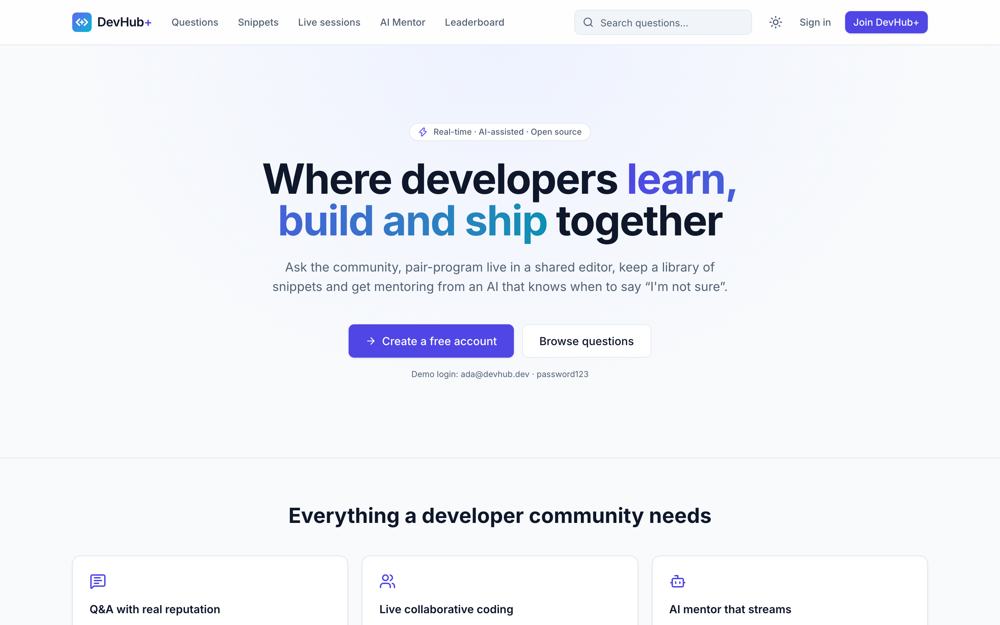
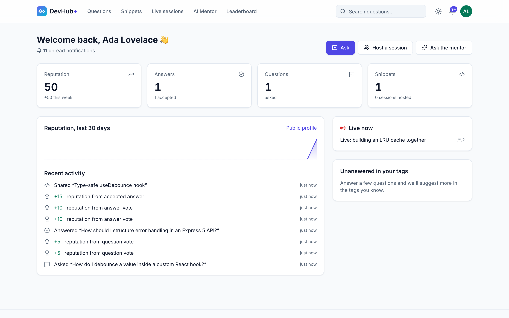
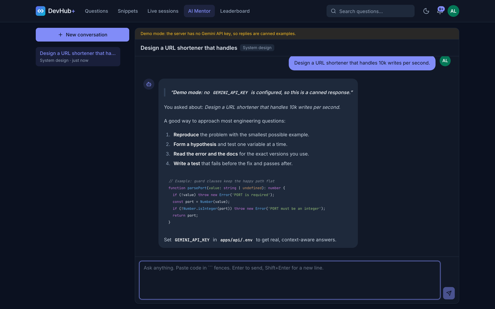
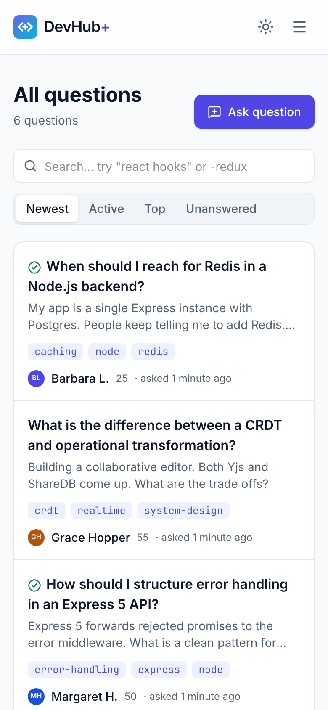

<div align="center">


# DevHub+

**A real-time developer community: Q&A with reputation, live coding sessions with a shared editor, whiteboard and video call, a snippet library and a streaming AI mentor.**

[](https://github.com/pankajbaid567/DevHub-/actions/workflows/ci.yml)


</div>

## Contents

- [What it does](#what-it-does)
- [Engineering highlights](#engineering-highlights)
- [Architecture](#architecture)
- [Tech stack](#tech-stack)
- [Quick start](#quick-start)
- [Testing](#testing)
- [Project structure](#project-structure)
- [Documentation](#documentation)
- [Screenshots](#screenshots)

## What it does

| Feature | Details |
|---|---|
| **Q&A with reputation** | Ask, answer, vote and accept answers. Reputation is computed in the same database transaction as each vote and recorded in an auditable ledger. Postgres full-text search with ranking and `"phrase"`, `-exclude` and `or` syntax. |
| **Live collaborative coding** | A shared Monaco editor synchronised with **Yjs CRDTs** over Socket.IO, with remote cursors, presence, typing indicators and chat. Private sessions use invite codes. Capacity is enforced under a row lock, and the host can start and end sessions. |
| **Shared whiteboard** | Draw together in the same session, with live strokes and remote cursors. It has pen, highlighter, eraser, colours and widths, per-user undo and redo (Yjs `UndoManager`), host-only clear and PNG export. It is stored in the same CRDT document as the code, so it syncs across servers and persists automatically. |
| **Video and voice calls** | **WebRTC** peer-to-peer calls in each session, with mute, camera, screen share (switched in place with `replaceTrack`), a speaking indicator and automatic rejoin. Uses perfect negotiation, server-side signalling restricted to call members, and STUN plus optional TURN. Up to 6 people (mesh). |
| **Streaming AI mentor** | Multi-turn conversations streamed token by token over Server-Sent Events, with topic-specific system prompts (debugging, code review, system design and more) and saved history. |
| **AI resume analyser and skills** | On your own profile (private tabs): upload a resume PDF and get a Gemini-powered, schema-validated review (0–100 scores per section, ATS keywords present and missing, top actions), with review history. Self-rated skills become a phased roadmap. |
| **Snippet library** | Share, star and fork code, with public, unlisted or private visibility and full-text search across title, description and code. |
| **Notifications** | Answers, acceptances, upvotes, stars and session starts are pushed live to every open tab. |
| **Polished UI** | Light, dark and an optional cyberpunk theme, mobile-first layouts, optimistic updates, skeletons and empty states. WCAG AA contrast is verified with axe. |

Try it locally with the seeded demo account **`ada@devhub.dev` / `password123`**.


## Engineering highlights

These are the parts I'd point a reviewer to.

- **Verified horizontal scaling.** `docker compose up --scale api=3` runs several stateless API replicas behind nginx. Socket.IO rooms span instances through the Redis adapter, CRDT updates are relayed between instances, and cache and rate limits live in Redis. A test client in the Docker network puts two users on different replicas and confirms they co-edit, chat and see each other ([details](docs/SYSTEM_DESIGN.md#horizontal-scaling)).
- **Correctness under concurrency, proven by tests.**
  - Votes are idempotent: concurrent duplicate votes become one vote, through a unique constraint plus a bounded retry.
  - The capacity race for the last seat in a session is closed with `SELECT … FOR UPDATE`.
  - Document saves CRDT-merge under a row lock instead of overwriting each other.
  - The reputation ledger invariant `users.reputation = SUM(events)` is asserted after each scenario.
- **Resilient AI integration.** Gemini sits behind a provider interface:
  - The primary model gets 60% of the time budget, and a timeout or overload falls back to a second model.
  - A circuit breaker skips a failing primary for 60 seconds.
  - Structured output is validated with zod before it's stored.
  - All of this is unit-tested with a fake client.
- **Security by design.**
  - Access tokens live only in memory (15 minutes).
  - Refresh tokens are httpOnly, `SameSite=Strict` cookies that rotate on every use, with reuse detection that revokes the whole token family.
  - Every input is validated with shared zod schemas, and private content returns 404 rather than 403.
  - Markdown is sanitised, PDF uploads are checked by magic bytes, login timing is equalised, and helmet plus a strict CSP are in place.
  - See [SECURITY.md](SECURITY.md).
- **Clean architecture.**
  - A composition root wires every service through constructor injection.
  - Strategy interfaces separate concerns: `AIProvider` (Gemini or a demo provider) and `Cache` (Redis or memory).
  - A domain event bus (observer pattern) decouples notifications from the code that triggers them.
  - Authorisation rules live together in one policy module.
  - Each route is declared once, which produces the Express handler, the validation and the OpenAPI docs together, so they cannot drift.
- **One contract for both sides.** `packages/shared` holds the zod schemas, DTO types and a **typed Socket.IO event map**, so a mismatched payload is a compile error in both the API and the web app.
- **Production operations.** Structured JSON logs with request IDs, Prometheus metrics, liveness and readiness probes, graceful shutdown that flushes collaborative documents, multi-stage non-root Docker images, and CI with E2E tests against a real stack.

## Architecture



Inside the API, every module follows **route → service → Prisma**, with cross-cutting concerns as middleware:



There's much more in [docs/ARCHITECTURE.md](docs/ARCHITECTURE.md): the data model ERD, sequence diagrams for token rotation, voting and collaborative editing, and the design patterns used.

## Tech stack

| Layer | Choices |
|---|---|
| **Web** | React 19, TypeScript (strict), Vite, Tailwind CSS 4, TanStack Query, React Router 7, react-hook-form + zod, Monaco, Yjs (`y-monaco`), Socket.IO client, react-markdown + rehype-sanitize |
| **API** | Node.js 20, Express 5, TypeScript (strict), Prisma 6, PostgreSQL 16, Socket.IO 4 + Redis adapter, ioredis, Yjs, zod, Pino, `@google/genai`, zod-to-openapi + Swagger UI |
| **Quality** | Vitest, Supertest, Socket.IO client tests, React Testing Library, Playwright, axe-core, ESLint (typescript-eslint, React hooks), Prettier |
| **Infrastructure** | Docker (multi-stage), Docker Compose, nginx, GitHub Actions |

## Quick start

### Option A: everything in Docker (recommended)

```bash
cp .env.example .env
# set JWT_ACCESS_SECRET, e.g. with: openssl rand -base64 48
docker compose up --build            # add --scale api=3 to run 3 API replicas
```

Open http://localhost:8080 and sign in as `ada@devhub.dev` / `password123`. The API docs are at http://localhost:8080/docs.

### Option B: local development with hot reload

Prerequisites: Node.js 20.19+ and Docker (for Postgres and Redis), or your own Postgres 14+.

```bash
npm install
npm run db:up                          # postgres + redis via docker compose
cp apps/api/.env.example apps/api/.env # set JWT_ACCESS_SECRET
npm run db:migrate && npm run db:seed
npm run dev                            # API on :4000, web on :5173 (proxied)
```

Without a `GEMINI_API_KEY`, the AI features use a deterministic demo provider, and the UI labels them as demo responses.

| Script | What it does |
|---|---|
| `npm run dev` | API and web with hot reload |
| `npm test` | Shared, API (needs Postgres) and web unit tests |
| `npm run e2e` | Playwright end-to-end tests (starts or reuses the dev servers) |
| `npm run lint` · `npm run typecheck` · `npm run format:check` | Static checks run in CI |
| `npm run build` | Production builds of every package |

## Testing

There are **102 automated tests**:

| Suite | Count | Covers |
|---|---|---|
| API integration and unit (`apps/api/test`) | 66 | Every endpoint against a real Postgres: auth and token rotation with reuse detection, voting idempotency and concurrency, the reputation ledger, accept/un-accept, privacy rules, session capacity races, chat pagination, SSE streaming, schema-validated AI output, PDF magic bytes, sockets (authentication, CRDT sync, identity spoofing), merge-on-save persistence, WebRTC signalling isolation, Gemini fallback and circuit breaker, OpenAPI, metrics |
| Shared (`packages/shared`) | 8 | Reputation maths and schema normalisation |
| Web unit and component (`apps/web/src`) | 15 | Single-flight token refresh, open-redirect guard, optimistic votes with rollback, markdown XSS sanitisation |
| End-to-end (`apps/web/e2e`) | 13 | Sign-up, sign-in and session restore. The two-user ask, answer, vote and accept loop with a live notification. **Two browsers co-editing one session.** **A whiteboard stroke syncing (and undo).** **A two-way video call with live remote video and mute state.** Profile-only resume tools. axe accessibility checks on five pages |

The E2E suite also passes against the production Docker stack (nginx, two API replicas, Redis, Postgres).

## Project structure

```
apps/
  api/                 Express 5 + Socket.IO API
    prisma/            schema + migrations (FTS triggers, CHECK constraints)
    src/
      config/          zod-validated environment
      core/            errors, validation, policies, event bus, route helper
      lib/             prisma, logger, cache, metrics
      middleware/      auth, request ids, logging, rate limits, error handler
      modules/         auth · questions · snippets · sessions · users · notifications · ai
      realtime/        Socket.IO gateway + Yjs DocManager
      container.ts     composition root (dependency injection)
    test/              integration + unit tests
  web/                 React SPA
    src/
      auth/ theme/     providers
      components/      UI kit, Markdown, CodeEditor, CollabEditor, Whiteboard, CallPanel, Layout
      lib/             API client, socket, SSE reader, useSessionDoc (Yjs), useCall (WebRTC), hooks
      pages/           route components (lazy-loaded)
    e2e/               Playwright specs
packages/
  shared/              zod schemas, DTO types, typed socket events, reputation rules
docs/                  architecture, system design, ADRs, audit, screenshots
```

## Documentation

- [Architecture](docs/ARCHITECTURE.md): layers, patterns, data model and sequence diagrams
- [System design](docs/SYSTEM_DESIGN.md): scaling, caching, consistency, failure modes and capacity
- [Architecture decision records](docs/adr/)
- [API](docs/API.md) and [real-time protocol](docs/REALTIME.md). The live OpenAPI docs are served at `/docs`.
- [Audit report](docs/AUDIT.md): what was wrong with the original MVP and how it was fixed
- [Security](SECURITY.md) · [Contributing](CONTRIBUTING.md)

## Screenshots

| | |
|---|---|
|  |  |
|  |  |
|  |  |

<p align="center"></p>

## License

MIT © Pankaj Baid
