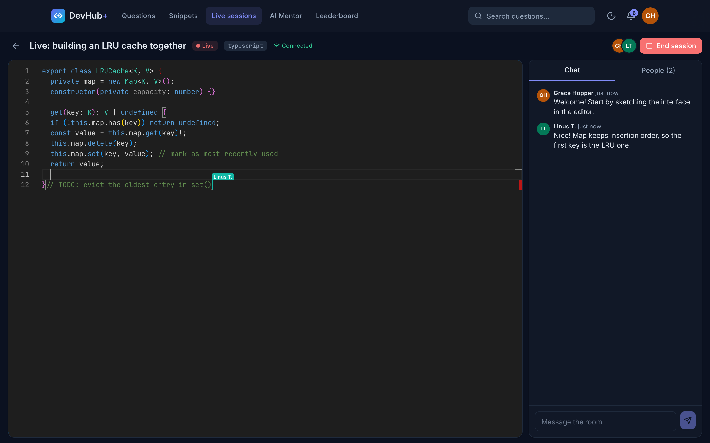
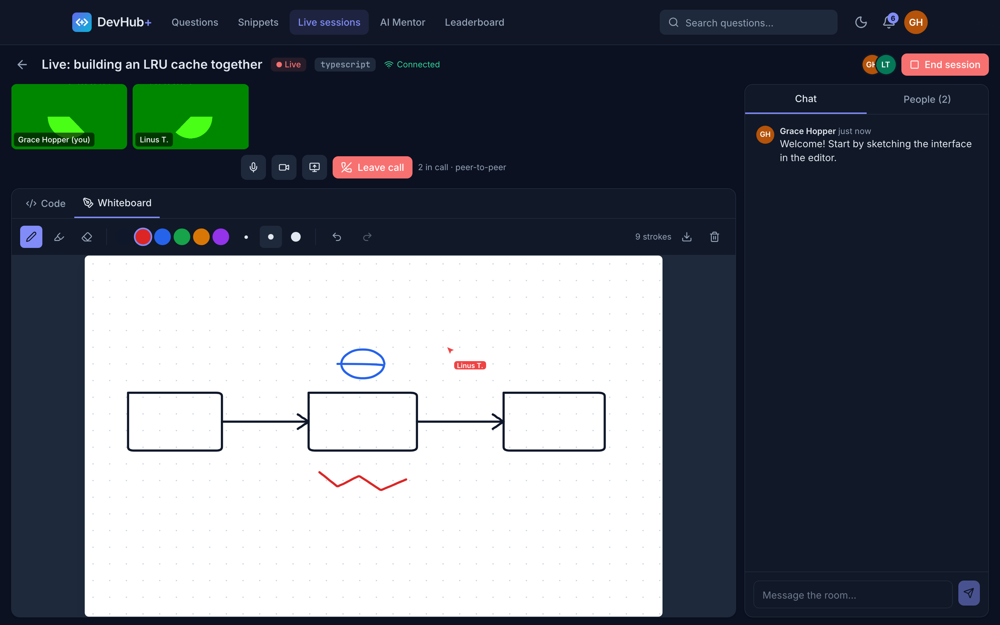
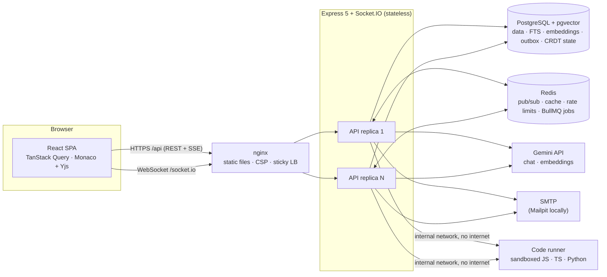
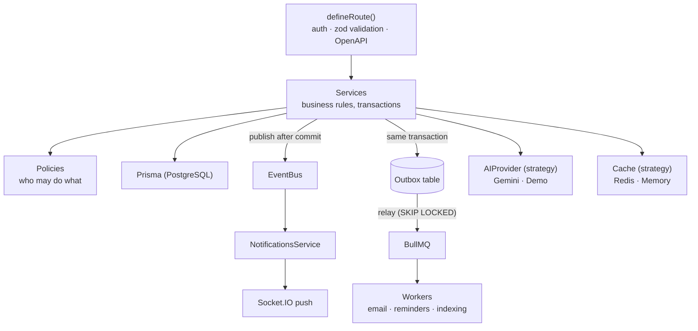
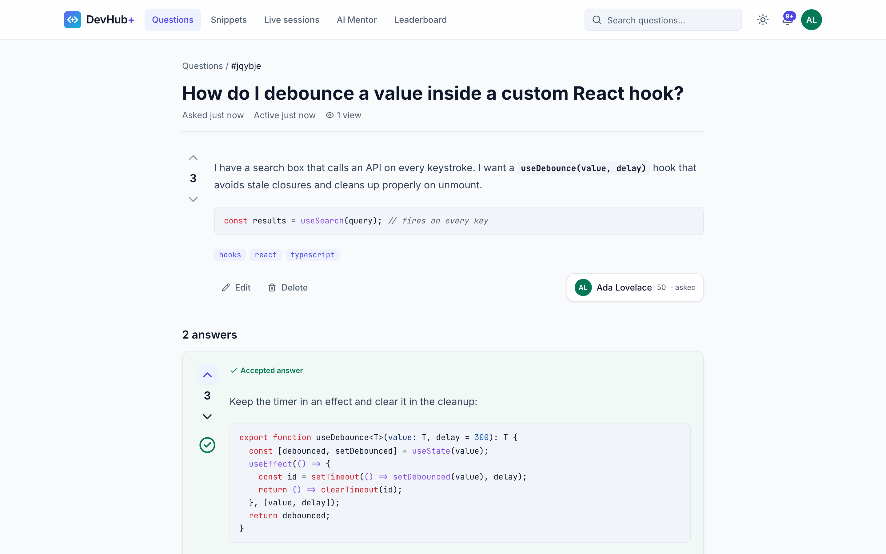
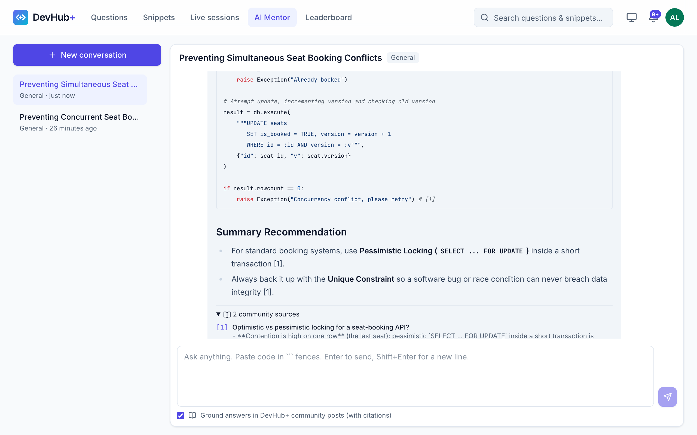
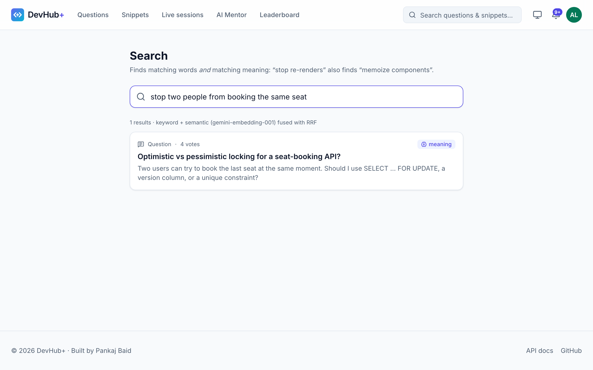
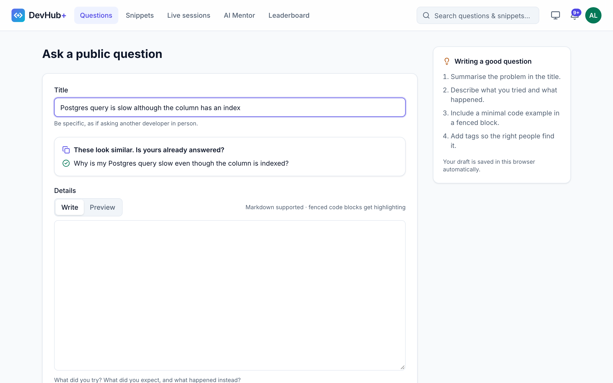
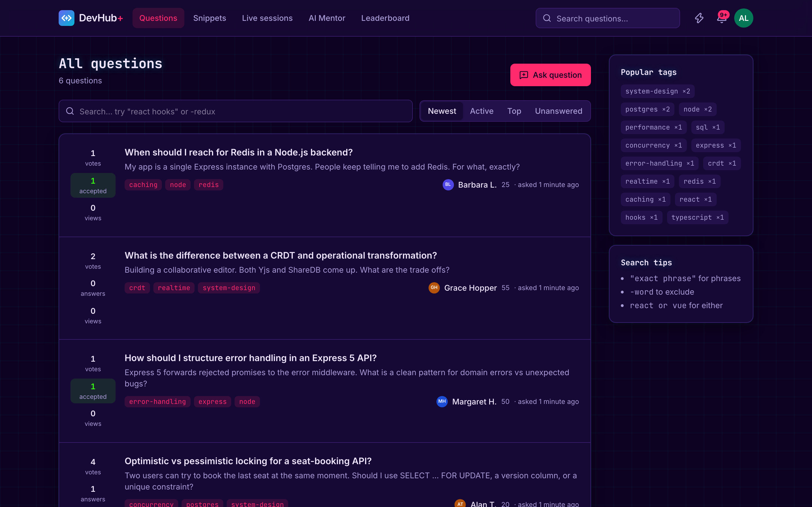
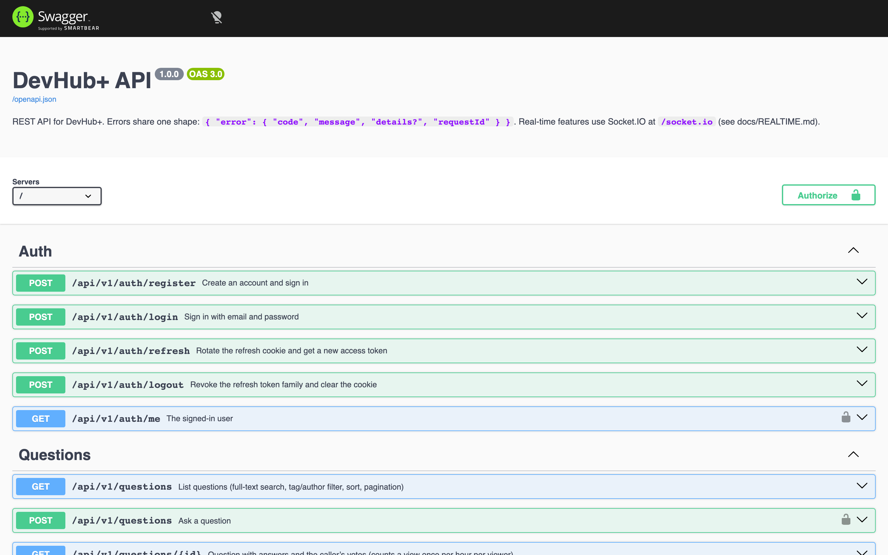

<div align="center">


# DevHub+

**A real-time developer community: Q&A with reputation, live coding sessions with a shared editor, whiteboard and video call, semantic search, and an AI mentor grounded in community answers.**

[](https://github.com/pankajbaid567/DevHub-/actions/workflows/ci.yml)




</div>

## Contents

- [What it does](#what-it-does)
- [Engineering highlights](#engineering-highlights)
- [Architecture](#architecture)
- [Tech stack](#tech-stack)
- [Quick start](#quick-start)
- [Testing](#testing)
- [Project structure](#project-structure)
- [Documentation](#documentation)
- [Screenshots](#screenshots)

## What it does

| Feature | Details |
|---|---|
| **Q&A with reputation** | Ask, answer, vote and accept answers. Reputation is computed in the same database transaction as each vote and recorded in an auditable ledger. Postgres full-text search with ranking and `"phrase"`, `-exclude` and `or` syntax. |
| **Live collaborative coding** | A shared Monaco editor synchronised with **Yjs CRDTs** over Socket.IO, with remote cursors, presence, typing indicators and chat. Private sessions use invite codes. Capacity is enforced under a row lock, and the host can start and end sessions. |
| **Run code together** | Press **Run** (or Ctrl/Cmd+Enter) in a session to execute the shared JavaScript, TypeScript or Python in a **sandboxed runner service**, with optional stdin. Everyone in the room sees "running…" and then the same output, exit status and timing. Run history is kept. |
| **Shared whiteboard** | Draw together in the same session, with live strokes and remote cursors. It has pen, highlighter, eraser, colours and widths, per-user undo and redo (Yjs `UndoManager`), host-only clear and PNG export. It is stored in the same CRDT document as the code, so it syncs across servers and persists automatically. |
| **Video and voice calls** | **WebRTC** peer-to-peer calls in each session, with mute, camera, screen share (switched in place with `replaceTrack`), a speaking indicator and automatic rejoin. Uses perfect negotiation, server-side signalling restricted to call members, and STUN plus optional TURN. Up to 6 people (mesh). |
| **AI mentor grounded in the community (RAG)** | Multi-turn conversations streamed token by token over Server-Sent Events. Before answering, the mentor retrieves the most relevant community answers (pgvector), favouring accepted and well-voted ones, and cites them inline as **[1]**, **[2]** with links to the source. You can switch grounding off per message. |
| **Semantic search** | Hybrid search that matches words *and* meaning: Postgres full-text and pgvector results fused with reciprocal rank fusion, with a badge showing how each result matched. While you type a question, likely **duplicates** appear before you post; every question shows **related questions**. |
| **AI resume analyser and skills** | On your own profile (private tabs): upload a resume PDF and get a Gemini-powered, schema-validated review (0–100 scores per section, ATS keywords present and missing, top actions), with review history. Self-rated skills become a phased roadmap. |
| **Snippet library** | Share, star and fork code, with public, unlisted or private visibility and full-text search across title, description and code. |
| **Accounts** | Email and password, or **Continue with GitHub / Google** (OAuth 2.0 with PKCE). Email verification, password reset by email, change or set a password, and automatic linking of a social login to an existing verified email. |
| **Notifications and email** | Answers, acceptances, upvotes, stars and session starts are pushed live to every open tab. Answers, acceptances and **session reminders 10 minutes before a scheduled start** are also emailed (opt-out in account settings), delivered by background jobs. |
| **Polished UI** | Light, dark and an optional cyberpunk theme, mobile-first layouts, optimistic updates, skeletons and empty states. WCAG AA contrast is verified with axe. |

Try it locally with the seeded demo account **`ada@devhub.dev` / `password123`**.



## Engineering highlights

These are the parts I'd point a reviewer to.

- **Verified horizontal scaling.** `docker compose up --scale api=3` runs several stateless API replicas behind nginx. Socket.IO rooms span instances through the Redis adapter, CRDT updates are relayed between instances, and cache and rate limits live in Redis. A test client in the Docker network puts two users on different replicas and confirms they co-edit, chat and see each other ([details](docs/SYSTEM_DESIGN.md#horizontal-scaling)).
- **Correctness under concurrency, proven by tests.**
  - Votes are idempotent: concurrent duplicate votes become one vote, through a unique constraint plus a bounded retry.
  - The capacity race for the last seat in a session is closed with `SELECT … FOR UPDATE`.
  - Document saves CRDT-merge under a row lock instead of overwriting each other.
  - The reputation ledger invariant `users.reputation = SUM(events)` is asserted after each scenario.
- **Reliable background work.** Emails, reminders and search indexing run as BullMQ jobs on every replica (competing consumers, retries with exponential backoff, failed jobs kept as a dead-letter set).
  - A **transactional outbox** writes each job in the same transaction as the change that causes it, so a crash can never lose a verification email or send one for a rolled-back sign-up.
  - Relays on several replicas share the table with `FOR UPDATE SKIP LOCKED`. The outbox row id becomes the job id, so a row relayed twice is delivered once.
  - Every handler is idempotent. A session reminder, for example, is claimed with one conditional `UPDATE … RETURNING`, so a re-delivered job can't remind twice. Tests replay crashes, race relays and run against real Redis.
- **Retrieval-augmented AI on Postgres.** Questions, answers (chunked with overlap) and snippets are embedded with Gemini (`gemini-embedding-001`, 768 dimensions, asymmetric query and document task types) into **pgvector** with an **HNSW** index.
  - Hybrid search fuses full-text and vector results with **RRF**.
  - Thresholds were calibrated on real embeddings and are documented next to the code.
  - Indexing is asynchronous and self-healing: a periodic reconcile job embeds anything missing, re-indexes everything when the model changes and drops orphans. Writers are serialised per document with an advisory lock.
  - Retrieved posts are passed to the model as tagged, untrusted data, a prompt-injection defence.
  - Without an API key, an offline feature-hashing embedder keeps every feature working in CI.
- **Sandboxed code execution, attacked on purpose.** User code runs in a separate `apps/runner` service with layered isolation:
  - **container:** an internal Docker network with no internet route, a read-only root filesystem, `cap_drop: ALL`, `no-new-privileges`, memory, CPU and pids limits, and tini to reap orphans;
  - **per run:** a scrubbed environment, a throwaway directory, ulimits (CPU, address space, processes, file size), output caps and a wall-clock `SIGKILL` of the whole process group;
  - **API:** editors only, live sessions only, a distributed one-run-per-session lock and a per-user cooldown.
  - Verified with hostile programs (network exfiltration, filesystem writes, environment snooping, a 1 GB allocation, `fork()` and `spawn()` bombs). Each is contained, and the next run still works ([results](docs/SYSTEM_DESIGN.md#sandboxed-code-execution)).
- **Resilient AI integration.** Gemini sits behind a provider interface:
  - The primary model gets 60% of the time budget, and a timeout or overload falls back to a second model.
  - A circuit breaker skips a failing primary for 60 seconds.
  - Structured output is validated with zod before it's stored.
  - All of this is unit-tested with a fake client.
- **Security by design.**
  - Access tokens live only in memory (15 minutes).
  - Refresh tokens are httpOnly, `SameSite=Strict` cookies that rotate on every use, with reuse detection that revokes the whole token family.
  - Every input is validated with shared zod schemas, and private content returns 404 rather than 403.
  - Markdown is sanitised, PDF uploads are checked by magic bytes, login timing is equalised, and helmet plus a strict CSP are in place.
  - OAuth uses `state` (login CSRF) and PKCE, a whitelist for return paths (no open redirect) and no tokens in URLs. Email links carry single-use tokens stored only as SHA-256 hashes, and "forgot password" answers identically whether or not the account exists. A password reset signs out every device.
  - See [SECURITY.md](SECURITY.md).
- **Clean architecture.**
  - A composition root wires every service through constructor injection.
  - Strategy interfaces separate concerns: `AIProvider` (Gemini or a demo provider), `Embedder` (Gemini or offline hashing), `JobQueue` (BullMQ or in-process), `Mailer` (SMTP or log) and `Cache` (Redis or memory).
  - A domain event bus (observer pattern) decouples notifications from the code that triggers them.
  - Authorisation rules live together in one policy module.
  - Each route is declared once, which produces the Express handler, the validation and the OpenAPI docs together, so they cannot drift.
- **One contract for both sides.** `packages/shared` holds the zod schemas, DTO types and a **typed Socket.IO event map**, so a mismatched payload is a compile error in both the API and the web app.
- **Production operations.** Structured JSON logs with request IDs, Prometheus metrics, liveness and readiness probes, graceful shutdown that flushes collaborative documents, multi-stage non-root Docker images, and CI with E2E tests against a real stack.

## Architecture



Inside the API, every module follows **route → service → Prisma**, with cross-cutting concerns as middleware:



There's much more in [docs/ARCHITECTURE.md](docs/ARCHITECTURE.md): the data model ERD, sequence diagrams for token rotation, voting and collaborative editing, and the design patterns used.

## Tech stack

| Layer | Choices |
|---|---|
| **Web** | React 19, TypeScript (strict), Vite, Tailwind CSS 4, TanStack Query, React Router 7, react-hook-form + zod, Monaco, Yjs (`y-monaco`), Socket.IO client, react-markdown + rehype-sanitize |
| **API** | Node.js 20, Express 5, TypeScript (strict), Prisma 6, PostgreSQL 16 + pgvector, Socket.IO 4 + Redis adapter, ioredis, BullMQ, Nodemailer, Yjs, zod, Pino, `@google/genai` (chat + embeddings), zod-to-openapi + Swagger UI |
| **Quality** | Vitest, Supertest, Socket.IO client tests, React Testing Library, Playwright, axe-core, ESLint (typescript-eslint, React hooks), Prettier |
| **Infrastructure** | Docker (multi-stage), Docker Compose, nginx, Mailpit, GitHub Actions |

## Quick start

### Option A: everything in Docker (recommended)

```bash
cp .env.example .env
# set JWT_ACCESS_SECRET, e.g. with: openssl rand -base64 48
docker compose up --build            # add --scale api=3 to run 3 API replicas
```

Open http://localhost:8080 and sign in as `ada@devhub.dev` / `password123`. The API docs are at http://localhost:8080/docs, and every email the app sends (verification, password reset, notifications) lands in Mailpit at http://localhost:8025.

### Option B: local development with hot reload

Prerequisites: Node.js 20.19+ and Docker (for Postgres and Redis), or your own Postgres 14+.

```bash
npm install
npm run db:up                          # postgres (pgvector) + redis + mailpit via docker compose
cp apps/api/.env.example apps/api/.env # set JWT_ACCESS_SECRET
npm run db:migrate && npm run db:seed
npm run dev                            # API on :4000, web on :5173 (proxied)
```

Without a `GEMINI_API_KEY`, the AI features use a deterministic demo provider (labelled in the UI) and semantic search uses an offline hashing embedder. "Continue with GitHub/Google" buttons appear once the client ids are set (see `.env.example`).

| Script | What it does |
|---|---|
| `npm run dev` | API and web with hot reload |
| `npm test` | Shared, API (needs Postgres) and web unit tests |
| `npm run e2e` | Playwright end-to-end tests (starts or reuses the dev servers) |
| `npm run lint` · `npm run typecheck` · `npm run format:check` | Static checks run in CI |
| `npm run build` | Production builds of every package |

## Testing

There are **170 automated tests**:

| Suite | Count | Covers |
|---|---|---|
| API integration and unit (`apps/api/test`) | 114 | Every endpoint against a real Postgres: auth and token rotation with reuse detection, voting idempotency and concurrency, the reputation ledger, accept/un-accept, privacy rules, session capacity races, chat pagination, SSE streaming, schema-validated AI output, PDF magic bytes, sockets (authentication, CRDT sync, identity spoofing), merge-on-save persistence, WebRTC signalling isolation, Gemini fallback and circuit breaker. **Outbox:** rollback writes no job, crash replay delivers once, concurrent relays, poison-row backoff, retries. **Email verification, password reset** (single use, concurrent resets, no enumeration, all devices signed out). **OAuth:** PKCE, state mismatch, open redirect, account linking. **Semantic search:** indexing, unchanged-content skip, reconcile after a model change, concurrent indexing, duplicates, hybrid RRF, RAG citations and graceful degradation. BullMQ against real Redis. **Code runs:** pushed to the room, one-at-a-time lock, outage handling, permissions. |
| Code runner (`apps/runner/test`) | 11 | Streams and stdin, runtime errors, infinite-loop kill, child-process group kill, output floods, environment scrubbing, per-run directories, back-pressure, token auth, validation |
| Shared (`packages/shared`) | 8 | Reputation maths and schema normalisation |
| Web unit and component (`apps/web/src`) | 15 | Single-flight token refresh, open-redirect guard, optimistic votes with rollback, markdown XSS sanitisation |
| End-to-end (`apps/web/e2e`) | 22 | Sign-up, sign-in and session restore. The two-user Q&A loop with a live notification. **Two browsers co-editing one session.** **Whiteboard sync and undo.** **A two-way video call.** **Email verification and password reset through a real SMTP inbox (Mailpit).** **Duplicate warning while asking, hybrid search and mentor citations.** **Running code in a session, with the output shown to both participants.** axe accessibility checks on eight pages |

The E2E suite also passes against the production Docker stack (nginx, two API replicas, Redis, Postgres).

## Project structure

```
apps/
  api/                 Express 5 + Socket.IO API
    prisma/            schema + migrations (FTS triggers, CHECK constraints, pgvector HNSW)
    src/
      config/          zod-validated environment
      core/            errors, validation, policies, event bus, route helper
      lib/             prisma, logger, cache, metrics
      middleware/      auth, request ids, logging, rate limits, error handler
      modules/         auth (+ OAuth, email tokens) · questions · snippets · sessions · users · notifications · ai · search (pgvector)
      jobs/            BullMQ / in-process queue, transactional outbox, mailer, email templates, handlers
      realtime/        Socket.IO gateway + Yjs DocManager
      container.ts     composition root (dependency injection)
    test/              integration + unit tests
  runner/              sandboxed code-execution service (no dependencies; hardened container)
  web/                 React SPA
    src/
      auth/ theme/     providers
      components/      UI kit, Markdown, CodeEditor, CollabEditor, Whiteboard, CallPanel, Layout
      lib/             API client, socket, SSE reader, useSessionDoc (Yjs), useCall (WebRTC), hooks
      pages/           route components (lazy-loaded)
    e2e/               Playwright specs
packages/
  shared/              zod schemas, DTO types, typed socket events, reputation rules
docs/                  architecture, system design, ADRs, audit, screenshots
```

## Documentation

- [Architecture](docs/ARCHITECTURE.md): layers, patterns, data model and sequence diagrams
- [System design](docs/SYSTEM_DESIGN.md): scaling, caching, consistency, failure modes and capacity
- [Architecture decision records](docs/adr/)
- [API](docs/API.md) and [real-time protocol](docs/REALTIME.md). The live OpenAPI docs are served at `/docs`.
- [Audit report](docs/AUDIT.md): what was wrong with the original MVP and how it was fixed
- [Security](SECURITY.md) · [Contributing](CONTRIBUTING.md)

## Screenshots

| | |
|---|---|
|  |  |
|  |  |
|  |  |
|  |  |
|  | |

<p align="center"></p>

## License

MIT © Pankaj Baid
