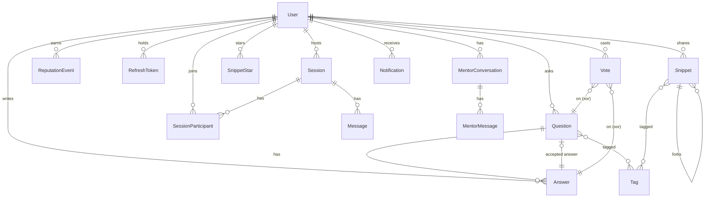
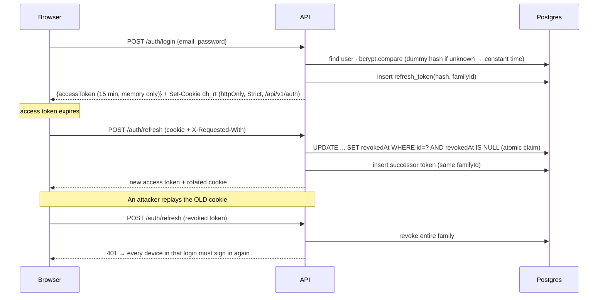
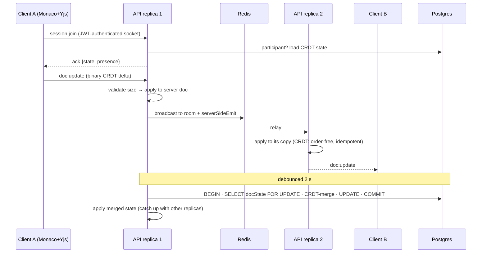

# Architecture

This document covers how DevHub+ is put together and why: the layers, the patterns, the data model and the key runtime flows. For scaling and operations, see [SYSTEM_DESIGN.md](SYSTEM_DESIGN.md). For individual decisions, see the [ADRs](adr/).

## 1. Monorepo layout

| Package | Responsibility |
|---|---|
| `packages/shared` | The **contract** between the two apps: zod schemas (which validate requests on the server and forms on the client), DTO types, typed Socket.IO event maps, reputation rules and error codes. |
| `apps/api` | REST, SSE and WebSocket API. Owns all business rules and all writes. |
| `apps/web` | The SPA. Holds no business rules beyond UX validation, which reuses the shared schemas. |

Because the schemas and event maps are shared, a renamed field or a changed payload breaks the TypeScript build of both apps, not production.

## 2. API layers

```
HTTP request
  → requestId → pino-http → metrics → helmet → CORS → JSON (200 kB cap) → cookies
  → rate limiter (Redis-backed)
  → defineRoute():  auth (JWT) → zod validation of params/query/body → handler
      → Service (business rules, transactions, policies)
          → Prisma → PostgreSQL
          → EventBus.emit(...) after commit → NotificationsService → Socket.IO push
  → error middleware: AppError → { error: { code, message, details?, requestId } }
```

### Patterns and where they live

| Pattern | Where | Why |
|---|---|---|
| **Composition root / dependency injection** | `src/container.ts` | The only place concrete classes are chosen. Tests swap in a fake AI provider and an in-memory cache without mocks or monkey-patching. |
| **Strategy** | `AIProvider` (`GeminiProvider`, `DemoProvider`), `Cache` (`RedisCache`, `MemoryCache`) | Swap infrastructure without touching business code. A keyless demo provider means the product works with no AI key. |
| **Observer (domain events)** | `core/events.ts` and `NotificationsService.subscribe` | Services publish facts ("answer accepted") without knowing who listens. A failing subscriber is isolated, so it can never fail the request. |
| **Policy objects** | `core/policies.ts` | All authorisation rules sit in one reviewable, unit-tested module. |
| **Declarative routes** | `core/route.ts` (`defineRoute`) | One definition produces the Express handler, auth, validation and the OpenAPI entry, so docs and code cannot drift. |
| **Typed error hierarchy** | `core/errors.ts` | Services throw `NotFoundError` or `ForbiddenError`, and one middleware maps them to stable error codes. Anything else is a bug: logged, and returned as a generic 500. |
| **Mapper / DTO** | `core/mappers.ts` and per-module `toDto` | The database shape never leaks. `userSummarySelect` makes "never return an email" structural rather than a convention. |
| **Retry with backoff** | `core/tx.ts` (`withRetry`) | Unique-constraint and serialisation races, such as concurrent first votes, retry the whole transaction a bounded number of times. |

### Consistency rules (ADR 0004)

- **Must be atomic with the action** → the same database transaction. Examples: vote rows, score counters, reputation and its ledger, `answerCount`, accepted-answer bonuses, session capacity.
- **May lag slightly** → domain events published after commit. Examples: notifications, socket pushes, cache invalidation.

## 3. Data model



Notable choices:

- **CUID primary keys.** They are unguessable, so ids cannot be enumerated (the original MVP used sequential integers).
- **Denormalised counters** (`score`, `answerCount`, `starCount`, `viewCount`) make list pages index-only sorts. Counters are only changed inside the same transaction as the source row, and `CHECK (... >= 0)` constraints guard them.
- **Reputation ledger.** `reputation_events` is append-only and `users.reputation` is a cache of its sum. The tests assert this invariant after every scenario.
- **Polymorphic vote.** A single `votes` table has two nullable foreign keys, `CHECK (num_nonnulls(questionId, answerId) = 1)`, and a unique key per `(user, target)`, which makes voting idempotent at the database level.
- **Full-text search.** A `tsvector` column is maintained by a trigger (title weighted A, body B) and has a GIN index. Because Prisma cannot see the trigger, schema diffs stay clean.
- **Collaborative document.** The Yjs CRDT state is stored as `bytea`, alongside a plain-text snapshot used for display and previews.

### Index strategy

| Query | Index |
|---|---|
| Newest, top-voted and active question lists | `(createdAt desc)`, `(score desc)`, `(lastActivityAt desc)` |
| Answers of a question by score | `(questionId, score desc)` |
| Public snippets by date or stars | `(visibility, createdAt desc)`, `(visibility, starCount desc)` |
| Live and scheduled public sessions | `(visibility, status, createdAt desc)` |
| Chat and notification feeds (keyset pagination) | `(sessionId, createdAt desc, id desc)`, `(userId, createdAt desc, id desc)` |
| Unread notifications count | `(userId, readAt)` |
| Leaderboard | `(reputation desc)` |
| Search | GIN on `searchVector` |

## 4. Key flows

### 4.1 Sign-in, refresh rotation and reuse detection



On the client, a single-flight refresh means ten concurrent 401s trigger exactly one refresh call, and every request then retries with the new token.

### 4.2 Voting (one transaction)

```mermaid
sequenceDiagram
  participant S as QuestionsService
  participant D as Postgres
  S->>D: BEGIN
  S->>D: load target (authorId) · reject self-vote · check downvote reputation
  S->>D: find existing vote (user,target) → from
  alt from == to
    S-->>S: no-op (idempotent)
  else
    S->>D: insert / update / delete vote row
    S->>D: score += to - from
    S->>D: author.reputation += Δ ; insert reputation_event
    S->>D: voter.reputation += cost ; insert reputation_event
  end
  S->>D: COMMIT  (P2002/P2034 → retry whole transaction)
  S-)S: emit content.upvoted → notification (after commit)
```

### 4.3 Collaborative editing



The whiteboard lives in the same document (`Y.Array('board')`, one `Y.Map` per stroke with a growing `Y.Array` of points), so it reuses this entire path: relay between replicas, merge-on-save, and catch-up after a reconnect. Video calls use the same socket only for WebRTC signalling (offers, answers and ICE candidates between call members); media flows peer to peer (ADR 0007).

Identity always comes from the handshake JWT. Payloads never carry a trusted user id (the original MVP trusted `userId` from the client).

### 4.4 AI mentor streaming

`POST /ai/conversations/:id/messages` stores the user's message, then streams `start → delta* → done` events over Server-Sent Events:

- **Errors.** The first event is pulled before the SSE headers are committed, so a missing conversation is still a normal JSON 404.
- **Cancellation.** If the browser disconnects, an `AbortController` cancels the model call, so no further tokens are paid for.
- **Persistence.** The assistant message is stored when the stream completes.
- **Structured tools.** For resume review and skills, a JSON Schema is derived from the zod schema and sent to Gemini as `responseJsonSchema`. The output is validated again with zod and retried once, and unvalidated model output is never stored.

## 5. Web architecture

- **Server state** lives in TanStack Query. Query keys come from a single factory (`qk`), so invalidation can't drift. Page changes keep the previous data visible, and votes and stars update optimistically with rollback.
- **URL state:** filters, sort and page live in search parameters (`useUrlState`), so every view is shareable.
- **Auth:** the access token is held in memory, the session is restored on load through the refresh cookie, and a non-secret hint skips that call for visitors who were never signed in.
- **Real-time:** a single typed socket per tab, whose `auth` callback reads the current token so reconnects re-authenticate.
- **Performance:** every route is lazy-loaded, and Monaco (3.8 MB) is bundled locally and loaded only by editor pages. Lists show skeletons, not spinners.
- **Accessibility:**
  - labelled fields with announced errors, live regions for chat and streaming;
  - a skip link and visible focus rings;
  - a native `<dialog>` for modals;
  - `prefers-reduced-motion` support;
  - axe checks in E2E.
