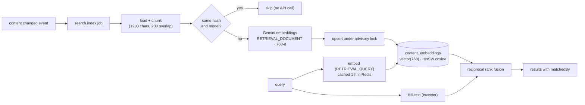

# System design

This covers how DevHub+ behaves under load and failure, what has been verified, and what I would change at larger scale.

## Requirements

| Functional | Non-functional |
|---|---|
| Q&A with votes, accepted answers, reputation, search | Reads p95 < 150 ms; writes p95 < 300 ms |
| Real-time collaborative editing, presence, chat | Edit propagation < 100 ms within a region; no lost edits |
| Notifications pushed live | At-least-once creation; push is best effort, with a REST fallback |
| AI mentor (streaming), resume and skill analysis | Bounded cost: per-user hourly limit and timeouts |
| | Horizontal scalability, graceful degradation without Redis or AI |

## Back-of-envelope sizing

Assume 100k registered users, 10k daily active, and 1k concurrent at peak.

- **Reads.** About 50 page views per DAU per day is 500k requests a day, roughly 6 rps on average and around 60 rps at peak. One API instance handles this comfortably. Postgres is the first real bottleneck, not Node.
- **WebSockets.** Assume 1k concurrent sockets, with 5% in live sessions (50 rooms of about 4 people). A burst of 5 Yjs updates per second per active editor is about 1k messages per second fanned out, which is trivial for Socket.IO. Memory is about 50 KB per socket, so roughly 50 MB.
- **Storage.**
  - Questions plus answers are about 2 KB each; 1M posts is about 2 GB, plus indexes.
  - CRDT state is typically 1–3 times the text size, and is capped at 200k characters per session.
  - Chat is about 200 B per message.
- **AI.** The cost driver is capped at 30 requests per user per hour by default, with a 45 s timeout and abort-on-disconnect.

## Horizontal scaling

```
             ┌─────────── nginx (ip_hash, WS upgrade, SSE unbuffered) ───────────┐
             ▼                          ▼                          ▼
        API replica 1             API replica 2             API replica N     (stateless)
             │  ▲                       │  ▲                       │  ▲
             ▼  │  Socket.IO Redis adapter: rooms, broadcasts, fetchSockets, serverSideEmit
          ┌──────────── Redis: pub/sub · cache · rate-limit counters · view de-dup ────────┐
          └────────────────────────────── PostgreSQL ─────────────────────────────────────┘
```

- **The API is stateless.** Sessions are JWTs, rate limits and caches live in Redis, and uploads are processed in memory without touching disk.
- **Socket.IO** uses the Redis adapter, so a broadcast to `session:<id>` reaches clients on every replica. Presence uses `fetchSockets()`, which is cluster-wide.
- **Sticky sessions.** These are needed only for Socket.IO's HTTP long-polling fallback, and nginx provides them with `ip_hash`. WebSocket-only clients would not need them.
- **Collaborative documents** live as one in-memory Yjs doc per active session per replica:
  - Client updates are applied locally, broadcast to the room, and relayed to other replicas with `serverSideEmit`.
  - CRDT merges are commutative and idempotent, so copies converge regardless of order or duplicates.
  - Persistence merges rather than overwrites: under `SELECT … FOR UPDATE`, the stored state and the replica's state are merged, and the result is fed back to the replica. A lost relay therefore cannot lose edits.

**Verified.** With `docker compose up --scale api=2`, a test client inside the Docker network connects user A to replica 1 and user B to replica 2:

- each sees the other's presence;
- CRDT edits and chat cross the replicas;
- the persisted document contains both users' edits.

This test found two real bugs, both now fixed and covered by regression tests:

1. A relay payload was corrupted by msgpack encoding.
2. Replicas overwrote each other's saves.

**At larger scale** I would route each session to an owner replica (consistent hashing on session id), or use `y-redis` and its streams. That removes duplicated documents and makes persistence single-writer.

## Video calls

Calls are WebRTC **mesh**: each participant uploads one stream per peer.

- At 6 people and about 500 kbps per stream, that's about 2.5 Mbps up per person, which is fine for small pairing rooms. That's why the server caps calls at 6.
- The server's only cost is signalling (a few dozen small messages per pair), relayed across replicas through the Redis adapter.
- Membership is checked once per peer pair and cached on the socket, so ICE candidates don't each trigger a cluster lookup.
- STUN handles most networks. Strict corporate NATs need TURN (for example coturn), which can be enabled through the environment.
- **Next step:** an SFU (LiveKit or mediasoup) for large rooms, recording and simulcast, keeping the same `rtc:*` signalling contract.

## Background jobs and the outbox

```mermaid
sequenceDiagram
  participant S as Service (e.g. register)
  participant PG as Postgres
  participant R as Outbox relay (every replica)
  participant Q as BullMQ (Redis)
  participant W as Worker (any replica)
  S->>PG: BEGIN · INSERT user · INSERT outbox(email.send) · COMMIT
  S-->>R: poke() (low latency; a 2 s poll is the safety net)
  R->>PG: SELECT … FOR UPDATE SKIP LOCKED LIMIT 50
  R->>Q: add(job, jobId = outbox-<row id>)
  R->>PG: UPDATE outbox SET dispatchedAt = now()
  Q->>W: lease job
  W->>W: handler (idempotent) · retry with exponential backoff on failure
```

- **Why an outbox:** "commit, then enqueue" loses the job if the process dies in between or Redis is down. "Enqueue, then commit" emails people whose sign-up rolled back. Writing the job as a row in the same transaction removes both windows.
- **Delivery is at-least-once, effects are once:** a relay crash after `add` but before marking the row makes it relay again, but BullMQ ignores a duplicate `jobId`. Handlers check state before acting. The session reminder claims its row with `UPDATE sessions SET "reminderSentAt" = now() WHERE … AND "reminderSentAt" IS NULL RETURNING …`, so concurrent or repeated runs remind once (a test caught the naive check-then-act version sending duplicates).
- **Scheduling:** a reminder row carries `availableAt = start − 10 min`. Rows due within the hour go to BullMQ as delayed jobs; later ones wait in Postgres, so far-future work never sits in Redis.
- **Poison rows:** a row the queue rejects backs off quadratically (capped at 5 min) instead of hot-looping the relay. This was observed live, when a job id format BullMQ rejects kept failing. Both queue implementations now enforce BullMQ's id rules, so tests catch it.
- **Workers:** every replica relays and (unless `WORKER_ENABLED=false`) consumes. That's competing consumers with leases, so a crashed worker's job is retried elsewhere. Repeating jobs (`maintenance.cleanup` hourly, `search.reconcile` every 10 min) are deduplicated across replicas by their scheduler id. Failed jobs are kept for 7 days as a dead-letter set. Redis runs with AOF persistence and the default `noeviction` policy, which BullMQ requires.
- **Without Redis** (development, tests), an in-process queue with the same semantics (retries, delays, idempotent ids) runs the same handlers.

## Semantic search and RAG



- **Storage:** one row per chunk in `content_embeddings`, with an HNSW index (`m = 16`, `ef_construction = 64`) on cosine distance. Answers are chunked with overlap and prefixed with their question's title, so a passage deep in a long answer is retrievable and keeps its context.
- **Hybrid ranking:** full-text is precise for exact tokens (error messages, API names), vectors find paraphrases. RRF (`Σ 1/(60 + rank)`) merges the lists by position, because `ts_rank` and cosine similarity are not on comparable scales.
- **Calibration (measured, not guessed):** with `gemini-embedding-001` and asymmetric task types on the seed corpus, near-duplicates scored 0.74–0.79, related posts and paraphrases 0.66–0.74, topical-but-wrong matches up to 0.61 and unrelated text about 0.50. Thresholds: duplicate warning ≥ 0.70 (precision), related ≥ 0.65, hybrid search ≥ 0.63 and RAG citation ≥ 0.64 (recall, because results are ranked and the model ignores irrelevant sources). Document-to-document similarity turned out compressed (0.70–0.84 across unrelated backend topics), so "related questions" embeds the title as a query instead of comparing stored vectors.
- **RAG:** the 30 nearest question and answer chunks are reduced to the best chunk per document and re-ranked with community signals (+0.04 for an accepted answer, +0.01·ln(1 + votes)). The top 5 are given to the model inside `<community_sources>` tags marked as untrusted reference data (prompt-injection hardening). The model cites `[n]` only where a source supports a point, and the citations are stored with the message.
- **Self-healing index:** indexing is asynchronous, so a slow embedding API never slows down posting. The reconcile job embeds anything missing for the *current* model, so switching models re-indexes everything automatically, and it deletes orphans. Two writers of one document are serialised with `pg_advisory_xact_lock(hashtext(kind:id))` plus an upsert. That race was found live, when a boot-time reconcile overlapped the scheduler's first run, and it's now a test.
- **Degradation:** if embeddings fail, the mentor answers ungrounded and search returns keyword results. Without a key, a feature-hashing embedder (word unigrams, bigrams and character trigrams) keeps everything working offline, with its own calibrated thresholds.
- **Scale:** at 768 dimensions × 4 bytes, about 3 KB per chunk, 1M chunks is about 3 GB plus the index, which is comfortable on one Postgres. Next steps: `halfvec` (2× smaller), iterative index scans for filtered queries, then a dedicated vector store only if recall or latency demands it.

## Sandboxed code execution

Running strangers' code is the riskiest thing the product does, so it is isolated in layers, each of which assumes the one inside it can fail:

| Layer | Controls |
|---|---|
| **API** (`RunsService`) | Participants with edit rights only, live sessions only, code ≤ 64 KB and stdin ≤ 16 KB, one run per session at a time (a Redis `SET NX` lock that holds across replicas), a 2 s per-user cooldown. Runner outages become a stored `failed` run, not a 500. |
| **Runner service** (`apps/runner`) | Bearer token checked in constant time, a bounded concurrency semaphore with a bounded queue (back-pressure: 503 instead of overload), no dependencies. |
| **Per run** (`sandbox.ts`) | A fresh temporary directory deleted afterwards; an environment reduced to `PATH`, `HOME` and `LANG` (no tokens); `ulimit` for CPU time, address space (Python), processes, file size and core dumps; the V8 heap capped; a 5 s wall clock, then `SIGKILL` to the whole process group (repeated, to beat fork races); 64 KB output caps. |
| **Container** (`docker-compose.yml`) | An `internal: true` network with no gateway, `read_only` root filesystem, a 64 MB `nosuid,nodev` tmpfs, `cap_drop: [ALL]`, `no-new-privileges`, 512 MB memory, 1 CPU, `pids_limit: 128`, a non-root user, and `init: true` (tini reaps zombies). |
| **Next** | For hostile public traffic: run the container under gVisor (`runtime: runsc`) or Firecracker microVMs, and add per-run network namespaces and seccomp profiles. |

Verified against the running Docker stack with deliberately hostile programs:

| Program | Result |
|---|---|
| `urllib.request.urlopen("https://example.com")` | No route, killed at the 5 s limit |
| `open("/srv/pwned", "w")` | `OSError: Read-only file system` |
| Print `process.env` | Only `PATH, HOME, LANG, PYTHONIOENCODING, PWD, SHLVL` |
| `bytearray(1 GiB)` | `MemoryError` |
| `while True: os.fork()` | Contained, killed at 5 s; **the next run succeeds** |
| `for(;;) spawn("sleep", ["60"])` | Contained, killed at 5 s; next run succeeds; 4 processes left in the container |

The first version failed the fork-bomb test in an instructive way. The bomb was killed, but its orphans became zombies, because Node as PID 1 doesn't reap them. They held the pids cgroup at its limit, so the *next* run couldn't start a thread. The fix was tini, a per-user process ulimit and a repeated group kill.

## Caching

| Data | Strategy | TTL | Invalidation |
|---|---|---|---|
| Leaderboard | Read-through (`cached()`) | 60 s | Time-based. Staleness is acceptable. |
| Popular tags | Read-through | 5 min | Explicit delete when a question is created |
| Question view de-duplication | `SET NX EX` per viewer | 1 h | Expiry |
| Rate-limit windows | Redis counters | Per window | Expiry |
| Query embeddings | Read-through, keyed by model and text hash | 1 h | Expiry (vectors are immutable for a model) |

Caches are behind the `Cache` interface: Redis in production, an in-memory bounded FIFO when Redis is absent.

## Consistency and concurrency

| Hazard | Mitigation | Test |
|---|---|---|
| Two concurrent first votes by one user | Unique `(userId, targetId)` plus whole-transaction retry | `survives concurrent duplicate votes` |
| Last seat in a session taken twice | `SELECT … FOR UPDATE` on the session row | `enforces capacity under concurrent joins` |
| Two refreshes with the same token | Conditional `UPDATE … WHERE revokedAt IS NULL` (atomic claim) | `allows only one of two concurrent refreshes` |
| Counter drift | Counters only change inside the source row's transaction, plus `CHECK >= 0` | Ledger invariant assertions |
| Lost edits across replicas | CRDT merge under a row lock | `merges concurrent saves under a row lock` |
| Demo seed raced by several replicas | Postgres advisory lock | Verified with two replicas in Compose |
| A job relayed twice (crash after enqueue) | Outbox row id used as the BullMQ job id | `delivers once even if a row is relayed twice` |
| Two relays claiming the same rows | `FOR UPDATE SKIP LOCKED` | `lets several relays run concurrently` |
| A reminder job delivered twice | Conditional `UPDATE … RETURNING` claim | `schedules a reminder … and sends it once` |
| A reset link submitted twice | Conditional `UPDATE email_tokens … RETURNING` | `lets only one of two concurrent resets … succeed` |
| Two indexers writing one document | Advisory transaction lock plus upsert | `tolerates concurrent indexing of the same document` |

## Failure modes

| Failure | Behaviour |
|---|---|
| **Redis down** | Readiness check fails (`/ready` returns 503, so the load balancer stops routing). Existing instances keep serving REST, and ioredis retries in the background. In development, the API simply runs without Redis. |
| **Gemini quota, overload or hang** | The primary model gets 60% of the time budget; then the fallback model runs with the remainder. After 2 consecutive failures a circuit breaker routes straight to the fallback for 60 s. If both fail, a `503 AI_UNAVAILABLE` with a friendly message (mentor streams send an `error` event). This was observed live: the primary returned 503 "high demand" errors, and every feature kept working on the fallback. |
| **No AI key** | `DemoProvider` gives deterministic, clearly labelled responses. |
| **Client disconnects mid-edit** | Yjs state is held locally. On reconnect the client re-joins and re-sends its state, and CRDT merging resolves it. |
| **API instance killed** | `SIGTERM` stops accepting work, flushes dirty documents, closes sockets and pools, with a 10 s forced-exit guard. Debounced edits at risk are at most about 2 s per document, and they still exist on clients and on other replicas. |
| **SMTP down** | The `email.send` job fails and BullMQ retries with exponential backoff; after 5 attempts it stays in the failed set for inspection. The request that caused it already succeeded. |
| **Redis down (jobs)** | Jobs keep accumulating safely in the outbox table, and the relay backs off. When Redis returns, they flow, and nothing is lost. |
| **Embedding API down** | Indexing jobs retry and the reconcile sweep catches up later. The mentor answers ungrounded, and search falls back to keyword results. |
| **Notification handler throws** | Isolated by the event bus and logged. The original request still succeeds. |
| **Slow or unbounded input** | JSON body capped at 200 kB, PDFs at 2 MB, Yjs updates at 256 KB, documents at 200k characters, chat at 10 messages per 10 s per socket, page size at 50. |

## Observability

- **Logs:** Pino JSON with a `requestId` on every line, the same id returned in the `X-Request-Id` header and in error bodies. Secrets are redacted.
- **Metrics (`/metrics`, Prometheus):**
  - `http_requests_total` and `http_request_duration_seconds`, labelled by **route pattern** to keep cardinality bounded;
  - `socket_events_total` and `ai_requests_total` (by outcome);
  - process memory and uptime.
- **Probes:** `/health` (liveness) and `/ready` (Postgres and Redis).
- **Jobs:** `jobs_total{name,outcome}` and `job_duration_seconds{name}`. The outbox's `attempts` and `lastError` columns show anything stuck.

## Search

Keyword search is Postgres full-text: a weighted `tsvector`, a GIN index, `websearch_to_tsquery` (which accepts user syntax safely) and `ts_rank_cd` (ADR 0005). Meaning-based search adds pgvector and fuses the two (see [Semantic search and RAG](#semantic-search-and-rag), ADR 0009). Both stay inside Postgres, with no extra cluster to run or keep in sync. For facets at very large scale I'd add OpenSearch fed by change-data-capture.

## What I'd do next at 10× and 100×

1. **Read replicas** for list and search queries, keeping the primary for writes and transactions.
2. **Session-owner routing** for collaborative documents, or move to `y-redis`.
3. **Move remaining after-commit events onto the outbox** (in-app notifications for votes and stars still use the in-process event bus; emails, reminders and indexing already use the outbox).
4. **CDN** for static assets, with `immutable` caching already in place.
5. **Resume reviews as jobs** on the existing queue, with progress pushed over the socket, so long AI calls don't hold HTTP connections.
6. **Hot-question cache** with stampede protection.
7. **Dedicated worker deployment** (`WORKER_ENABLED=false` on web replicas), scaled on queue depth.
